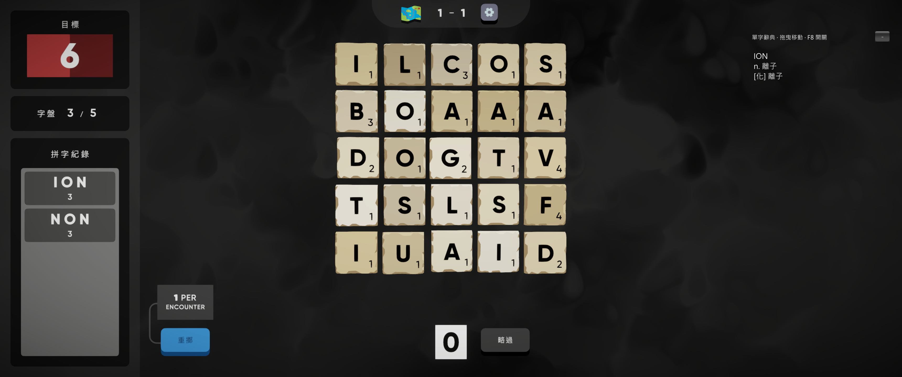
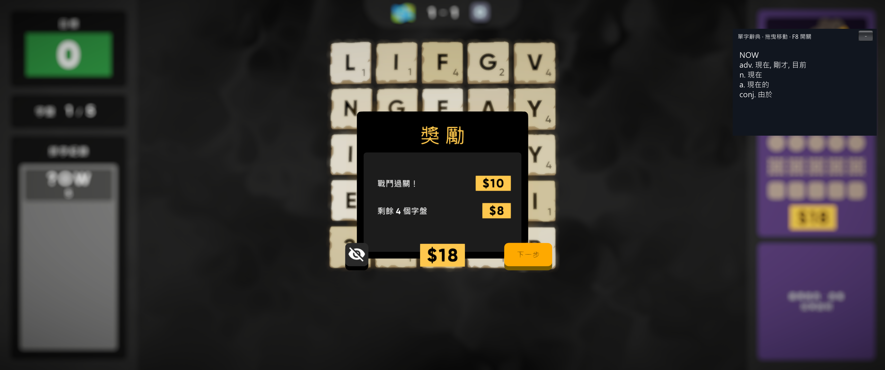
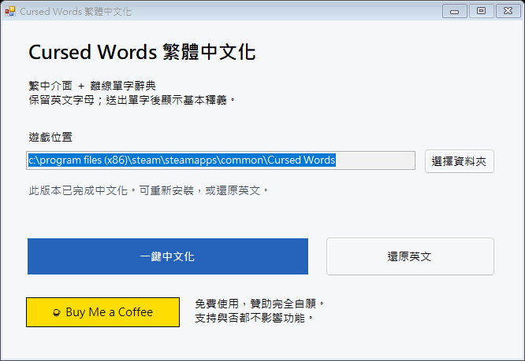

# Cursed Words 繁體中文化與離線單字辭典

為 Steam Windows 版《Cursed Words》提供繁體中文介面、教學、規則與對話；送出英文單字後，以遊戲內浮窗顯示繁體中文基本釋義，方便邊玩邊學英文。

這份中文化最初是為了家人，尤其是還在讀小學的女兒。希望她能用熟悉的文字理解遊戲，也讓拼字過程多一些學習英文的機會，並分享給有需要的玩家。

補丁免費提供；喜歡這個專案，歡迎自願請我喝杯咖啡，支持校對與維護。支持與否都不影響任何功能。

**[下載一鍵安裝器](https://github.com/koehhian/cursed-words-zh-hant/releases/latest) · [使用指南](docs/USER_GUIDE.md) · [驗證紀錄](docs/VALIDATION.md) · [問題回報](https://github.com/koehhian/cursed-words-zh-hant/issues)**

## 功能

- 繁中介面、教學、角色對話、道具與動態獎勵提示；保留英文字母與拼字判定。
- 約 36 萬筆離線詞庫，使用 ECDICT 資料轉為繁中並補上詞形對應及部分常用字修訂。
- 數字、問號字塊使用遊戲本次判定的完整單字，與角色對話一致；一次多個單字會分別列出。
- 釋義保留到下次送出單字；浮窗可拖曳、縮小、捲動，F8 顯示／隱藏。
- 一鍵 EXE，自動尋找 Steam 遊戲；備份原始程式，可還原英文。一般玩家不需要 Python。

## 安裝

1. 自行安裝 [Steam 版 Cursed Words](https://store.steampowered.com/app/3856460/)，並關閉遊戲。
2. 從 [Releases](https://github.com/koehhian/cursed-words-zh-hant/releases/latest) 下載 Windows ZIP 並解壓縮。
3. 執行 `CursedWordsZHant.exe`，確認遊戲資料夾，按「一鍵中文化」，完成後從 Steam 啟動。

## 相容性與限制

適用 Steam Windows **遊戲版本 4.12**，以原始遊戲 DLL 的 SHA-256 核對；不相容版本會停止安裝。遊戲更新後可能需要新版補丁。

本專案提供非官方玩家補丁，需自行持有原遊戲。公開 EXE 使用差異補丁，在玩家電腦上以原始檔產生修改結果，不內含完整的原始或修改後遊戲 DLL；安裝／還原不操作存檔。

對話與主要用語已校訂，尚未逐一遊玩所有角色和道具組合。詞庫可能缺少冷僻字，或包含專業及舊式用語。

## 原始碼與權利

翻譯主檔在 `source/translations.json`；重建見 [開發指南](docs/DEVELOPMENT.md)。工具原創程式採 MIT 授權；遊戲內容、衍生翻譯與截圖的原有權利屬其權利人，詳見 [LICENSE](LICENSE) 與 [第三方聲明](THIRD_PARTY_NOTICES.md)。
